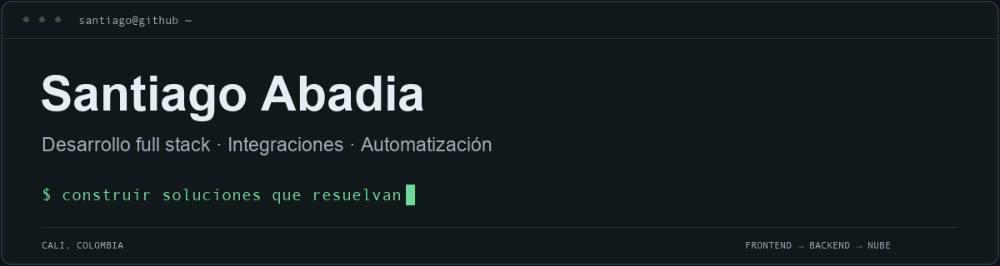

  

### Software para procesos reales.

Desarrollo aplicaciones web, APIs e integraciones que conectan interfaces, datos y servicios. Mi trabajo abarca el frontend, el backend y el despliegue, con foco en simplificar la operación.

### En qué trabajo

- Aplicaciones y paneles para operaciones de negocio.
- APIs, autenticación e integración con servicios externos.
- Automatización e IA aplicada a procesos: agentes, herramientas y recuperación de información.

### Stack de trabajo

#### Frontend

 &nbsp;  &nbsp;  &nbsp;  &nbsp;  &nbsp; 

TypeScript · React · Next.js · Angular · Vue · Tailwind CSS

#### Backend

 &nbsp;  &nbsp; 

Node.js · NestJS · Express

#### Datos

 &nbsp;  &nbsp;  &nbsp; 

PostgreSQL · MySQL · Redis · Supabase

#### Nube y entrega

 &nbsp;  &nbsp;  &nbsp;  &nbsp; 

AWS S3 · Vercel · Railway · Docker · GitHub Actions

#### Testing

 &nbsp; 

Playwright · Vitest

#### IA aplicada

 &nbsp;  &nbsp;  &nbsp; 

OpenAI · Claude · Gemini · MCP

**IA aplicada:** agentes · tool calling · RAG · bases vectoriales.

### Contacto

[LinkedIn ↗](https://www.linkedin.com/in/santiago-abadia-g%C3%B3mez-a90ba2235/)
